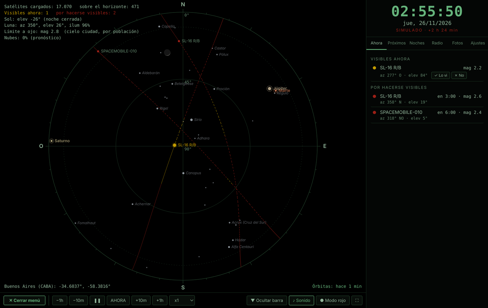
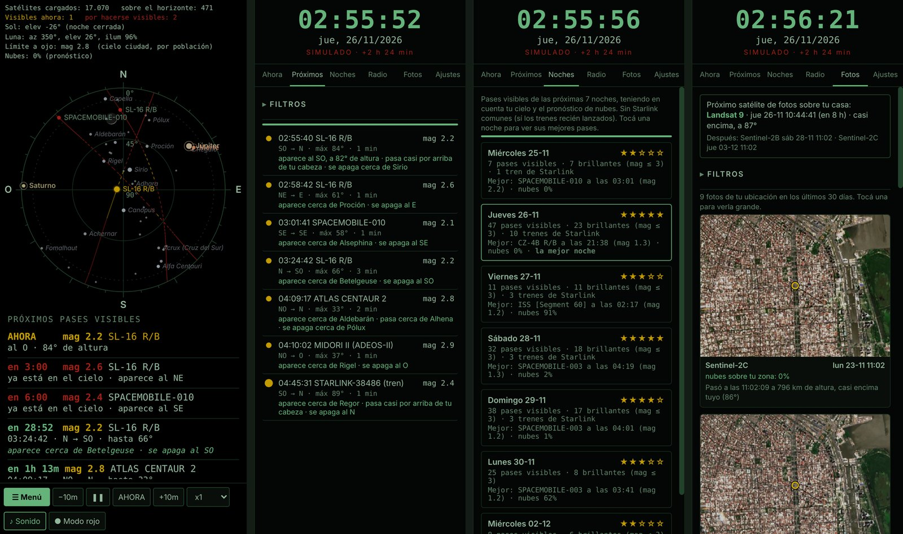

# SatRadar

**Radar de satélites que se pueden ver a ojo desnudo, para Windows.** Muestra en un radar los satélites que vas a poder ver desde tu casa esta noche, con la hora exacta, por dónde aparecen y qué tan brillantes son. Es gratis y no necesita cuenta.

## Descargar

1. Entrá a **[Releases](../../releases/latest)** y bajá `SatRadar-Setup-X.Y.Z.exe`.
2. Abrilo e instalá. No pide permisos de administrador.
3. Listo. Cuando sale una versión nueva, la app muestra un cartel con el botón **Instalar ahora**.

> Windows puede avisar "Windows protegió su PC" porque el instalador no tiene firma digital paga. Tocá **Más información → Ejecutar de todas formas**.

Funciona en Windows 10 y 11.

## Cómo se lee el radar

- **El borde** es el horizonte, **el círculo del medio** está a 45° de altura y **el centro** es justo arriba de tu cabeza.
- **Amarillo**: el satélite se ve ahora. Lleva su recorrido dibujado.
- **Rojo**: ya está en el cielo pero todavía no se ve (sigue en la sombra de la Tierra o muy bajo). Solo aparece si se va a hacer visible en ese pase.
- **Gris**: el pase terminó.
- Cuando un satélite pasa de rojo a amarillo suena un aviso suave.

Los satélites que no van a llegar a verse no se muestran: de los más de 17.000 que hay en órbita, en el radar solo aparecen los que vale la pena salir a buscar.

## Cómo decide qué se ve

Para cada satélite calcula:

- **Si le da el Sol** mientras para vos ya es de noche (si está en la sombra de la Tierra no se ve).
- **Qué tan brillante se ve**, según su tamaño, la distancia y el ángulo con que refleja el Sol.
- **Qué tan oscuro está tu cielo**: contaminación lumínica estimada por la población cercana, la Luna, el crepúsculo y las nubes del pronóstico.

El límite de brillo se puede dejar en automático o elegir a mano. Además, si marcás los pases con **✓ Lo vi / ✗ No**, la app aprende cuánto se ve en tu cielo y se ajusta sola.

## Qué trae

**Para mirar el cielo**
- Próximos pases con la hora exacta al segundo, dirección, altura máxima y brillo.
- Guía con estrellas y planetas: "aparece cerca de Betelgeuse, se apaga al SO".
- Aviso antes de cada pase, con sonido.
- Planificador de las próximas 7 noches con estrellas según cuántos pases buenos hay y el pronóstico de nubes.
- Trenes de Starlink recién lanzados.
- Ubicación automática con el servicio de Windows (por las redes wifi cercanas).

**Fotos reales de tu casa**
- Las fotos que los satélites Sentinel-2 y Landsat sacaron de tu ubicación en los últimos días, con las nubes sobre tu punto y el pase exacto que las tomó.
- Cuándo pasa el próximo satélite de fotos por encima tuyo.

**Para radioaficionados**
- Pestaña de radio con las frecuencias de cada satélite (SatNOGS), corrección Doppler y control de SDR++ por rigctl.

**Otras pantallas**
- **En el celular**: con la PC y el celular en la misma red wifi, escaneás un código QR y ves el radar en el teléfono.
- **En OBS**: vista con fondo transparente para usar en transmisiones en vivo.
- Modo nocturno rojo para no encandilarte, colores de letra a elección y tamaños de letra y líneas ajustables.

## Datos y créditos

Todos los datos vienen de fuentes públicas y gratuitas:

- **Órbitas**: [CelesTrak](https://celestrak.org) y, opcionalmente, [Space-Track](https://www.space-track.org) (con cuenta gratuita).
- **Brillo de los satélites**: catálogo de Mike McCants y [GCAT](https://planet4589.org/space/gcat/) de Jonathan McDowell.
- **Frecuencias de radio**: [SatNOGS](https://db.satnogs.org).
- **Nubes**: [Open-Meteo](https://open-meteo.com).
- **Estrellas**: catálogo Hipparcos, vía [d3-celestial](https://github.com/ofrohn/d3-celestial) (BSD-3).
- **Imágenes**: contienen datos modificados de Copernicus Sentinel-2 (ESA) y Landsat (USGS/NASA), obtenidos vía [Microsoft Planetary Computer](https://planetarycomputer.microsoft.com).
- La búsqueda exacta de pases y la idea de las fotos se basan en [Watched](https://github.com/dev-Armaan/satellites), de Armaan Gupta (licencia MIT).
- Cálculo de órbitas con [satellite.js](https://github.com/shashwatak/satellite-js).
